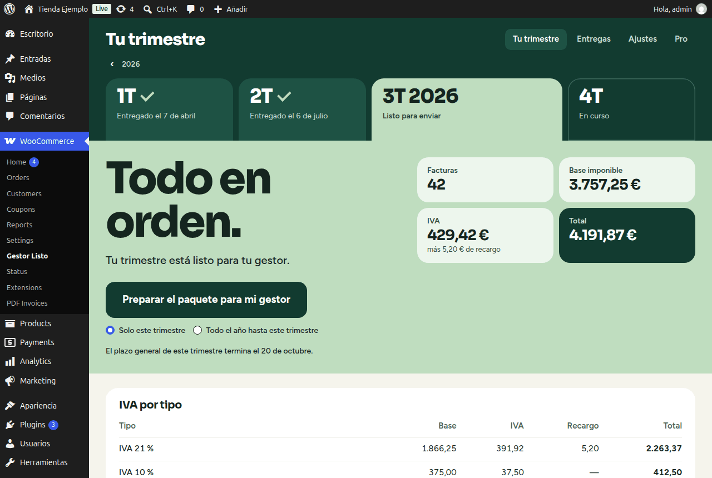
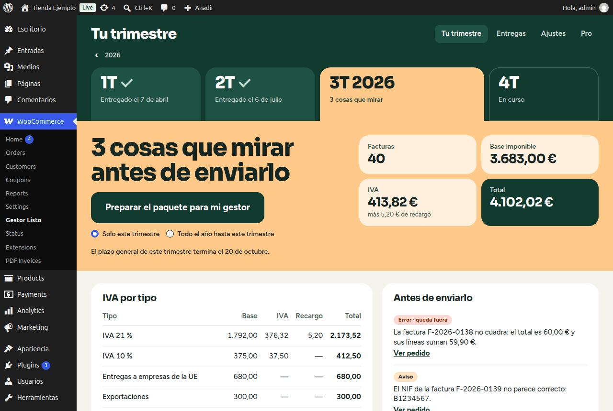
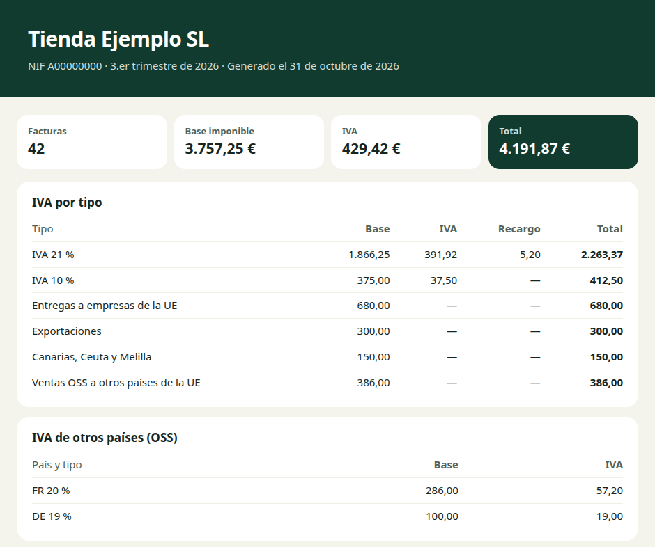
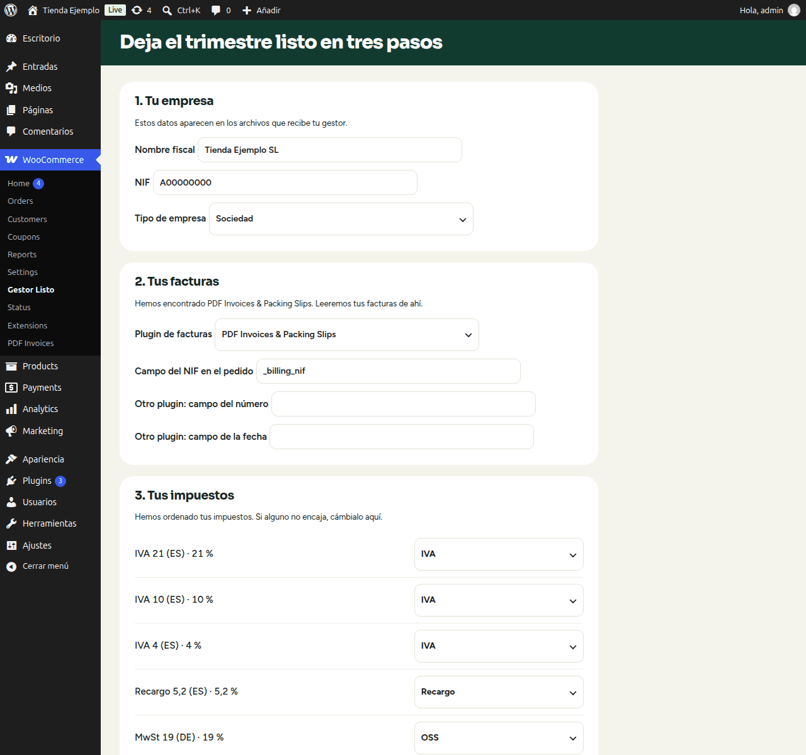
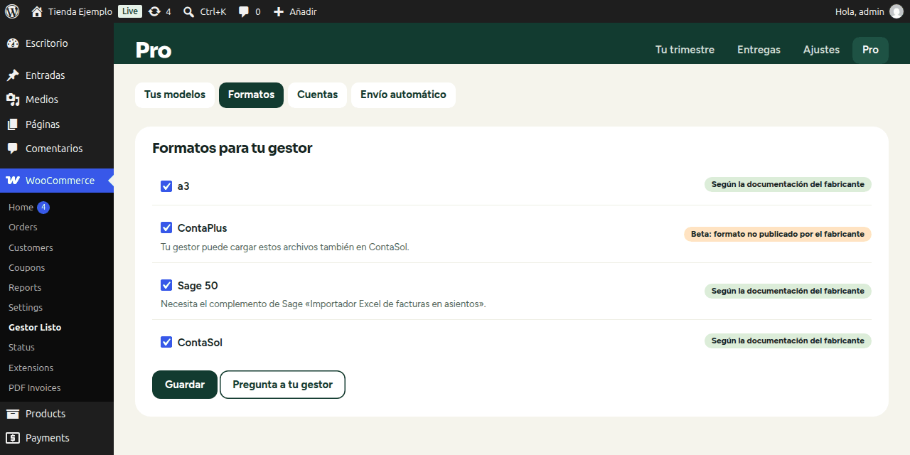

# Gestor Listo para WooCommerce

**Qué es:** un plugin gratuito para WooCommerce que junta las ventas del trimestre en un único paquete para tu gestor. Solo ventas: no incluye compras ni gastos, y nunca crea ni cambia tus facturas.\
**Para quién:** tiendas WooCommerce en España que hacen sus facturas con un plugin de facturas y cada tres meses pasan las ventas a un gestor.\
**Cómo se usa:** 1) instálalo y rellena sus tres pasos de ajustes; 2) elige el trimestre y revisa los avisos; 3) descarga el paquete y envíaselo a tu gestor.

👉 **[Descargar gestor-listo-for-woocommerce.zip](https://github.com/Facilo-es/gestor-listo/releases/latest/download/gestor-listo-for-woocommerce.zip)** (última versión, gratis)

\
*Tu trimestre de un vistazo: facturas, base, IVA y total, y el botón para preparar el paquete de tu gestor.*

## Lo que gana tu tienda

Si a tu gestor le llega un montón de PDF, alguien tiene que teclearlos, y ese tiempo lo pagas tú, o llegan las preguntas de última hora. Con Gestor Listo le entregas el trimestre ordenado y sin huecos.

- **Un trimestre sin sorpresas:** facturas, base, IVA y total de un vistazo, con el IVA por tipo.
- **Nada que se escape:** te avisa antes de enviarlo de pedidos sin factura, huecos en la numeración, devoluciones sin rectificativa y facturas que no cuadran.
- **Menos horas de tu gestor:** el libro registro de facturas emitidas en Excel, con el formato que publica la Agencia Tributaria, y un CSV de ventas que se abre en cualquier programa.
- **Ventas a la UE en orden:** un resumen por país de tus ventas OSS.
- **Todas tus facturas juntas:** un ZIP con cada factura en PDF.

Sin registro, sin límite de pedidos y sin conectar tu tienda con nadie: tus datos se quedan en tu tienda. En español.

## Así se ve

\
*Antes de enviarlo, te dice qué falta o no cuadra, con un enlace a cada pedido.*

\
*El resumen que va en el paquete: IVA por tipo, ventas a la UE, exportaciones y OSS por país.*

\
*Los tres pasos de ajustes. Detecta tu plugin de facturas y ordena tus impuestos por ti.*

\
*Solo en Pro: archivos de importación para el programa de contabilidad de tu gestor.*

## Instalación

1. Descarga **[gestor-listo-for-woocommerce.zip](https://github.com/Facilo-es/gestor-listo/releases/latest/download/gestor-listo-for-woocommerce.zip)**.
2. En WordPress, ve a **Plugins → Añadir nuevo → Subir plugin**, elige el zip y actívalo. Necesitas WooCommerce activo.
3. Ve a **WooCommerce → Gestor Listo** y sigue los tres pasos de configuración.

## Gestor Listo Pro: tu gestor importa el trimestre y deja de teclear facturas

- Archivos de importación para a3 (SUENLACE.DAT), ContaPlus, Sage 50 y ContaSol.
- Tus cuentas contables, como las usa tu gestor.
- Envío automático a tu gestor cada trimestre.
- Solo lo nuevo, si algo cambia después de enviarlo.
- Las cifras de tus modelos: el 303 cada trimestre, el 349 de ventas a la UE, el 369 de OSS, y el 347 y el 390 del año. Cubren solo tus ventas, y tu gestor las revisa y las presenta.

**59 € al año para una tienda, 149 € al año para cinco, más IVA.** 14 días de prueba sin tarjeta y 14 días de devolución.

👉 **[Probar Gestor Listo Pro 14 días gratis](https://checkout.freemius.com/plugin/44830/plan/79005/?trial=free)** · **[Comprar Gestor Listo Pro](https://checkout.freemius.com/plugin/44830/plan/79005/)**

Los archivos de Pro siguen el formato que publica cada programa y tienen pruebas automáticas. Todavía no los ha importado un gestor en su propio programa.

## Preguntas frecuentes

**¿Cubre compras y gastos, o solo ventas?**\
Solo ventas. Gestor Listo lee las facturas que emite tu tienda, y tus compras y gastos no pasan por WooCommerce. El libro registro lleva también la hoja de facturas recibidas, con sus columnas pero vacía, para que tu gestor añada los gastos como siempre.

**¿Qué plugins de facturas funcionan sin configurar nada?**\
Reconoce solo [PDF Invoices & Packing Slips for WooCommerce](https://wordpress.org/plugins/woocommerce-pdf-invoices-packing-slips/) y el plugin de facturas en PDF de WebToffee. Si usas otro, ve a **Ajustes → 2. Tus facturas**, elige **Otro plugin (campos personalizados)** y escribe en **Otro plugin: campo del número** el nombre del campo personalizado del pedido donde ese plugin guarda el número de factura. Si también guarda la fecha, ponla en **Otro plugin: campo de la fecha**; si no, se usa la fecha del pedido. Sin ningún plugin de facturas, usa los números de pedido y te avisa de que un pedido no es una factura.

**¿Con qué tamaño de tienda se ha probado?**\
Con pedidos de prueba generados por nosotros, no con una tienda real: un trimestre de 6.087 facturas tardó unos 18 segundos la primera vez y luego se abre al momento, porque el cálculo se guarda hasta que cambia un pedido. Un paquete de 4.000 documentos con 2.000 facturas en PDF se creó en unos 4 minutos y medio, con el límite de memoria de PHP en 256 MB.

**¿Cambia mis facturas o mis pedidos?**\
No. Solo los lee, y una prueba automática lo comprueba. Tampoco es un sistema Verifactu: Verifactu afecta al programa que crea tus facturas, y Gestor Listo no las crea.

## Actualizaciones

Por ahora, cada versión nueva sale en las [releases de este repositorio](https://github.com/Facilo-es/gestor-listo/releases): descarga el zip nuevo y súbelo igual que la primera vez, y WordPress te ofrece reemplazar la versión instalada. Cuando el plugin esté en wordpress.org, las actualizaciones llegarán también desde allí, en tu escritorio de WordPress.

## Importante

Gestor Listo es una herramienta, no asesoría fiscal: tu gestor sigue revisando y presentando tus impuestos. a3, ContaPlus, Sage 50 y ContaSol son marcas de sus dueños, y Gestor Listo no tiene relación con ellos.

Lo hace **Facilo**, un pequeño estudio de Andalucía. Soporte: support@facilo.es · [facilo.es](https://facilo.es) · Licencia GPLv2 o posterior.
